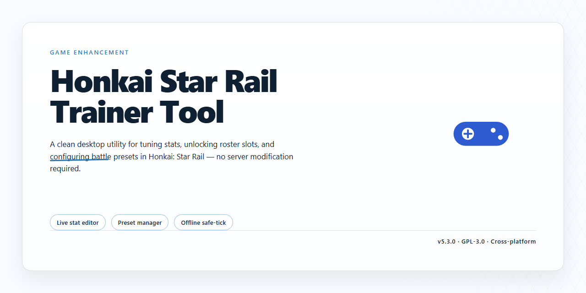

# Honkai Star Rail Trainer Tool — Game Enhancer for Windows

### 🚀 PowerShell Quick Install

   

---

The honkai-star-rail-trainer-tool delivers a complete standalone setup of Honkai Star Rail 2026 with every feature pre-activated and ready to run from the first launch. No configuration loops, no dependency hunting — the build ships locked and loaded so you can jump straight into the action. This package is built for players who want the full experience without the setup grind, with everything verified and intact out of the box.

## 📋 System Requirements

- **OS:** Windows 10 / 11
- **Shell:** PowerShell 5.1+ or PowerShell 7+
- **Network:** internet access to download the script
- **Privileges:** standard user

## Features

- **Everything unlocked out of the box.** The 2026 build ships with all features pre-activated — no grind through menus, no manual toggles, no post-install configuration. Launch it and everything's already live.

- **Fully standalone.** No external dependencies, no helper services, no background launchers. One self-contained package that runs on its own from the moment you unpack it.

- **Built for the 2026 game version.** Tuned specifically for the current HSR release cycle, so the tooling matches the live client instead of lagging a patch behind.

- **Complete feature set, pre-configured.** Every module included in the trainer is enabled by default — nothing stripped out, nothing locked behind a separate step.

- **Drop-in ready.** The setup is packaged for immediate use on Windows x64. Extract, run, and you're in — zero setup wizard, zero first-run tinkering.

- **Local-first by design.** Everything runs on your machine. No accounts to link, no sign-ins, no cloud round-trips before you can use the tool.

- **Clean, predictable footprint.** A single package that behaves like a proper desktop app — easy to move, easy to remove, nothing scattered across your system.

- **Verified and current.** The build is kept in sync with the latest confirmed state of the project, so what you download matches what's documented.

## How it works

The trainer hooks into the game process at runtime and flips the switches from the inside — no file patching, no permanent modification. Everything ships pre-configured in one standalone build, so there's nothing to compile, assemble, or wire up yourself.

Here's the flow:

- **Drop-in deployment.** The whole setup lives in a single self-contained directory. Launch it and the trainer attaches to the running game automatically — no manual process targeting, no window hunting.
- **Live memory read/write.** A lightweight overlay layer reads the game's state each frame and writes the values you toggle — stats, resources, multipliers, whatever the preset panel exposes. Changes land instantly, no restart required.
- **Pre-activated presets.** Every feature in the trainer is unlocked and enabled out of the box. No key checks, no unlock steps, no trial gates — the config ships fully armed.
- **Hotkey-driven control.** Toggle modules on the fly with keyboard shortcuts while the game runs. The overlay confirms state changes in real time, so you always know what's active.
- **Clean detach.** Close the trainer and the game returns to its stock state — nothing persists, nothing lingers in memory after shutdown.

Built to run local, stay self-contained, and keep the feedback loop tight: launch, toggle, play, close.

## Supported Games

Built specifically around Honkai Star Rail and its live service rhythm, this tool targets the platforms and setups that actually matter for players running the 2026 build.

- **Honkai Star Rail (PC, 2026 release)** — fully supported on the standalone Windows client. All features ship pre-activated, so there is no in-game unlocking, no config editing, and no post-install tinkering.
- **Windows x64 desktop** — the native target platform. The build is tuned for the standard desktop client rather than emulation layers or wrappers.
- **Standalone offline environment** — the tool runs entirely against the pre-activated local build. No launcher dependency, no online handshake required to get features working.

Support is scoped tight on purpose. Honkai Star Rail is the target, the 2026 client is the target, and Windows desktop is the target. If you're running that combination, you're covered end to end. Mobile clients, cloud versions, and older client revisions fall outside the supported surface and are not validated against this build.

## Configuration

Everything ships pre-activated — no launcher handshakes, no license prompts, no first-run wizards. Launch it and the feature set is live from frame one.

Tuning is handled through a plain-text config file sitting next to the executable. Open it in any text editor, flip what you need, save, relaunch. No encrypted blobs, no registry spelunking, no reinstall loop.

What's inside the config:

- **Feature toggles** — every module has its own on/off switch, and all of them default to enabled
- **Keybinds** — remap any hotkey to whatever layout you actually run; conflicts are flagged on load
- **Overlay flags** — independent controls for the in-game overlay and its HUD elements
- **Update channel** — pin yourself to the current build or follow the latest drop

Profiles are separate files, so you can keep a clean setup and a maxed-out setup side by side and swap between them without touching the defaults. Corrupt a value? The tool falls back to stock settings on the next launch instead of choking, and it tells you which line tripped it.

Nothing is written outside the install folder. Delete the directory and every trace is gone. That's the whole config model — flat, portable, and yours to break.

## FAQ

**Is this really standalone — no launcher, no account, no online check?**
Yes. The build ships complete and self-contained. Everything is pre-activated on first launch, so there's no login wall, no background patcher phoning home, and no dependency on any external service. Boot it, play it.

**Do I need to install anything else first?**
No. The package is fully bundled. No runtimes to hunt down, no frameworks to sideload, no package managers involved. Unpack, run, done.

**Which game version is this built against?**
It targets the Honkai Star Rail 2026 release and is synced to that build. If your game client is on a different version, expect mismatches — keep the trainer matched to the version it shipped with.

**Are all the features actually unlocked out of the box?**
Correct. Nothing is gated behind a paywall, a key, or a secondary unlock step. Every feature listed in the Features section is live the moment the tool initializes.

**Will it survive game updates?**
The trainer is version-locked by design. A major game patch can shift memory addresses and break hooks — that's normal for any trainer. Re-sync with the matching build rather than forcing it onto a newer client.

**Is it detectable / will I get flagged?**
This is a local, offline-oriented enhancement build intended for testing and single-player-style use. It doesn't inject into online matchmaking services. Still, use it on your own setup and your own risk tolerance — see the Disclaimer.

**Why does Windows SmartScreen or my antivirus complain?**
Unsigned standalone executables routinely trip heuristic flags. That's a reputation issue, not a payload issue. Whitelist the folder or temporarily pause real-time protection during first run, then re-enable it.

**Does it need an internet connection to run?**
No. Once the files are on disk, the tool operates fully offline. No telemetry, no license ping, no mandatory update check.

**Can I move it to another drive or machine?**
Yes — it's portable. Copy the whole folder intact and launch from the new location. Just keep the directory structure together so relative paths resolve.

**What do I do if a feature toggles but doesn't take effect?**
Close the game fully, relaunch the trainer first, then start the game. Order matters. If it still misbehaves, confirm your game build matches the supported version before anything else.

**Is there a config file I can edit?**
Yes — see the Configuration section for the exact file and keys. Defaults are tuned to work immediately; tweak only what you understand.

**Does this modify my save data?**
It operates on the running game session. Back up your saves before experimenting — standard practice, and cheap insurance.

## Disclaimer

This build is provided strictly for educational and local testing purposes. It is a standalone, pre-activated setup intended to run in an offline environment. You are responsible for how you use it.

This tool is not affiliated with, endorsed by, or connected to the official developers or publishers of Honkai Star Rail. All game assets, trademarks, and intellectual property belong to their respective owners.

Use it at your own risk. Running modified or pre-activated builds may violate the game's terms of service and could result in account restrictions. The maintainers of this project accept no liability for bans, data loss, or any other consequences that arise from use.

Always test on a separate account or environment. Keep your own backups. If you're not comfortable with the risks, don't run it.